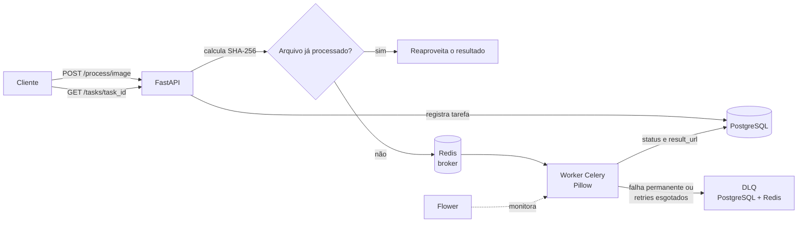

# AsyncTask Hub: API de Processamento Assíncrono de Imagens (FastAPI + Celery)


API para upload e redimensionamento de imagens em background, construída com **FastAPI**, **Celery**, **Redis** e **PostgreSQL**. O projeto aplica padrões de processamento assíncrono em back-end: **fila de tarefas**, **idempotência por conteúdo**, **Dead Letter Queue**, **classificação de falhas com retry**, **graceful shutdown do worker** e **testes automatizados**.

> Projeto de portfólio. O foco está no fluxo assíncrono e no tratamento de falhas, não no processamento de imagem em si.
>
> Projeto complementar: [API Gateway com Rate Limiting e Cache](https://github.com/PedroHTLemos/api-gateway-rate-limit-cache) (rate limiting, tiers por API key e cache-aside com lock anti-stampede).

---

## Sobre o projeto

A API recebe uma imagem, responde imediatamente com um `task_id` e delega o redimensionamento a um worker Celery. O cliente acompanha o andamento consultando o status da tarefa.

O projeto resolve três problemas comuns em processamento em background:

- **Não bloquear a API** enquanto o trabalho pesado acontece.
- **Não reprocessar arquivos repetidos**, identificando-os pelo conteúdo (hash SHA-256).
- **Não perder tarefas que falham**: falhas definitivas e tarefas que esgotam as tentativas são registradas em uma Dead Letter Queue consultável.

### Arquitetura



---

## Funcionalidades implementadas

**Processamento**
- Upload de imagem em `POST /process/image`, com retorno imediato de um `task_id`.
- Redimensionamento em background com Celery e Pillow: tamanho máximo de 800×800, saída em JPEG com qualidade 85.
- Consulta de status em `GET /tasks/{task_id}`, com os estados `pending`, `processing`, `retrying`, `completed` e `failed`.

**Idempotência**
- O arquivo é identificado pelo hash SHA-256 do conteúdo.
- Um arquivo idêntico que já foi processado com sucesso não volta para a fila: o resultado existente é reaproveitado.
- Mesmo reaproveitando o resultado, cada upload gera um novo registro, preservando o histórico.
- Apenas tarefas já concluídas (`completed`) são reaproveitadas: um arquivo idêntico enviado enquanto a primeira tarefa ainda está em andamento é enfileirado novamente.

**Tratamento de falhas**
- **Falhas permanentes** (imagem corrompida, arquivo ausente) vão direto para a DLQ, sem consumir retries.
- **Falhas transitórias** são tentadas até 3 vezes, com intervalo de 10 s, antes de ir para a DLQ.
- A DLQ é gravada no PostgreSQL (tabela `dead_letters`) e em uma lista do Redis.
- Listagem da DLQ em `GET /tasks/dead-letters`.

**Confiabilidade do worker**
- `task_acks_late` combinado com warm shutdown: ao receber `SIGTERM`, o worker para de aceitar novas tarefas e conclui a atual; tarefas interrompidas voltam para a fila (comportamento padrão do Celery, reforçado pelo stop_grace_period de 30 s no docker-compose).

**Proteção e monitoramento**
- Rate limit de 10 uploads por minuto por IP, com slowapi.
- Monitoramento das tarefas e do worker com Flower.
- Imagens processadas servidas pela própria API em `/static/processed/`, no caminho indicado em `result_url`.

### Endpoints

| Método | Rota | Descrição |
|---|---|---|
| `POST` | `/process/image` | Envia uma imagem e recebe o `task_id` (limite: 10 req/min por IP) |
| `GET` | `/tasks/{task_id}` | Consulta o status e o resultado de uma tarefa |
| `GET` | `/tasks/dead-letters` | Lista as tarefas registradas na Dead Letter Queue |

---

## Tecnologias utilizadas

| Categoria | Tecnologia |
|---|---|
| Linguagem | Python 3.12 |
| Framework web | FastAPI, Uvicorn |
| Validação e schemas | Pydantic |
| Fila de tarefas | Celery |
| Broker e result backend | Redis |
| Banco de dados | PostgreSQL 16 |
| ORM | SQLAlchemy 2 |
| Processamento de imagem | Pillow |
| Rate limiting | slowapi |
| Monitoramento | Flower |
| Testes | Pytest (SQLite em memória) |
| Containers | Docker, Docker Compose |

---

## Como executar

### Pré-requisitos

- Docker e Docker Compose
- Python 3.12 (somente para rodar os testes localmente)

### Subindo a aplicação

```bash
git clone https://github.com/PedroHTLemos/async-task-hub.git
cd async-task-hub
cp .env.example .env
cd docker
docker compose up -d --build
```

O Compose sobe cinco serviços: PostgreSQL, Redis, API, worker Celery e Flower.

| Serviço | Endereço |
|---|---|
| API | `http://localhost:8000` |
| Documentação interativa (FastAPI) | `http://localhost:8000/docs` |
| Flower | `http://localhost:5555` |

### Variáveis de ambiente

As variáveis ficam no `.env` (modelo em `.env.example`) e são lidas na inicialização da aplicação:

| Variável | O que configura |
|---|---|
| `DATABASE_URL` | Conexão com o PostgreSQL |
| `REDIS_URL` | Conexão com o Redis (usada pela DLQ) |
| `CELERY_BROKER_URL` | Broker do Celery |
| `CELERY_RESULT_BACKEND` | Result backend do Celery |
| `RATE_LIMIT_PER_MINUTE` | Declarada, mas ainda não utilizada: o limite de 10/min está definido diretamente no endpoint |

### Exemplos de uso

```bash
# Enviar uma imagem
curl -X POST http://localhost:8000/process/image \
  -F "file=@caminho/para/imagem.jpg"
# {"task_id": "...", "status": "pending"}  (ou "completed", se o mesmo arquivo já tiver sido processado)

# Consultar o status
curl http://localhost:8000/tasks/{task_id}
# Retorna task_id, status, result_url, error_message e created_at

# Listar a Dead Letter Queue
curl http://localhost:8000/tasks/dead-letters
```

---

## Organização do código

```
app/
├── api/          # Rotas FastAPI (upload, status, DLQ)
├── core/         # Configuração, conexão com o banco e rate limiter
├── static/       # Imagens: uploads/ (originais) e processed/ (redimensionadas, servidas em /static)
├── workers/      # celery_app.py (aplicação Celery) e tasks.py (processamento)
├── schemas/      # Modelos Pydantic de request e response
├── models.py     # Modelos SQLAlchemy (TaskRecord, DeadLetter)
└── main.py       # Entrypoint da API
docker/           # Dockerfile e docker-compose.yml
tests/            # Suíte Pytest
.env.example
requirements.txt
```

---

## Decisões técnicas e conhecimentos aplicados

**Resposta imediata e processamento fora da requisição.**
O endpoint de upload só valida, registra e enfileira a tarefa. O redimensionamento roda no worker Celery, então o tempo de resposta da API não depende do tamanho da imagem nem da carga do processamento.

**Idempotência pelo conteúdo, não pelo nome do arquivo.**
O hash SHA-256 identifica arquivos iguais mesmo com nomes diferentes. Se o mesmo conteúdo já foi processado, o resultado é reaproveitado sem nova ida à fila. O novo registro criado a cada upload mantém o histórico de envios sem duplicar trabalho.

**Falhas classificadas antes de decidir o retry.**
Tentar de novo uma imagem corrompida não muda o resultado, então falhas permanentes vão direto para a DLQ. Só falhas transitórias consomem as 3 tentativas. Isso evita ocupar o worker com retries que não têm chance de sucesso.

**Dead Letter Queue consultável.**
As tarefas que não puderam ser concluídas ficam registradas no PostgreSQL, com consulta via API, e em uma lista do Redis. Assim as falhas podem ser inspecionadas em vez de simplesmente descartadas.

**Entrega "pelo menos uma vez" no worker.**
Com `task_acks_late`, a mensagem só é confirmada no broker depois que a tarefa termina. Junto com o warm shutdown, um reinício do worker não descarta a tarefa em andamento: ela volta para a fila.

**Estado da tarefa persistido no PostgreSQL.**
O status (`pending` → `processing` → `retrying` → `completed`/`failed`) é gravado no banco pelo worker, e a consulta da API lê do banco. O histórico das tarefas continua disponível independentemente do result backend do Celery.

**Rate limit no endpoint de upload.**
O upload é a operação mais cara da API, então o limite de 10 requisições por minuto por IP é aplicado nele.

**Ordem das rotas.**
`/tasks/dead-letters` e `/tasks/{task_id}` compartilham o mesmo prefixo. Existe um teste específico garantindo que `dead-letters` não seja interpretado como um `task_id`.

**Testes independentes da infraestrutura.**
A suíte usa SQLite em memória e Celery mockado ou em modo eager, então roda sem PostgreSQL nem Redis.

**Ambiente reproduzível.**
Os cinco serviços sobem juntos com Docker Compose, com configuração centralizada em `.env`.

---

## Testes

O projeto possui 9 testes automatizados com Pytest, cobrindo:

- Upload e enfileiramento da tarefa.
- Idempotência: reenvio de um arquivo idêntico.
- Envio de arquivos diferentes.
- Consulta de status.
- Resposta 404 para `task_id` inexistente.
- Listagem da Dead Letter Queue.
- Conflito entre as rotas `/tasks/dead-letters` e `/tasks/{task_id}`.
- Falha transitória: retries até a DLQ.
- Falha permanente: envio direto para a DLQ.

Para executar:

```bash
pip install -r requirements.txt
cp .env.example .env
pytest -v
```

---

## Melhorias futuras

- Validação de tipo e tamanho máximo do arquivo antes de enfileirar.
- Idempotência também para tarefas em andamento, evitando processar o mesmo arquivo duas vezes em paralelo.
- Ler o limite de requisições da variável `RATE_LIMIT_PER_MINUTE` em vez do valor fixo no código.
- Backoff exponencial nos retries de falhas transitórias, no lugar do intervalo fixo de 10 s.
- Endpoint para reprocessar tarefas da DLQ.
- Testes de integração com PostgreSQL e Redis reais em containers, complementando os testes atuais com SQLite e Celery mockado.
- Pipeline de CI com GitHub Actions executando os testes a cada push.
