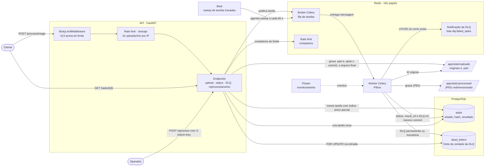
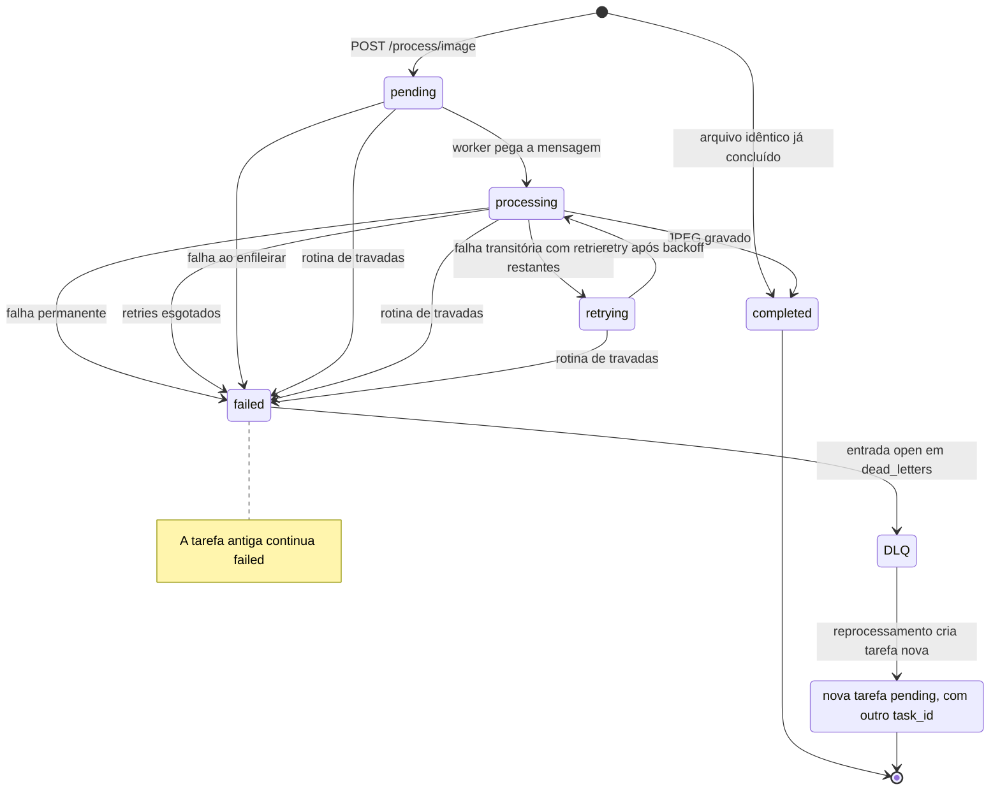

# AsyncTask Hub


API de upload com processamento assíncrono de imagens, construída com **FastAPI**, **Celery**, **Redis** e **PostgreSQL**. A requisição responde na hora, o trabalho roda em um worker, e cada falha tem um destino rastreável: retry, Dead Letter Queue (DLQ) ou reprocessamento manual.

> **Foco do projeto:** processamento assíncrono confiável e tratamento de falhas. O redimensionamento com Pillow é só a carga de trabalho usada para exercitar o fluxo. O projeto não é sobre processamento de imagem.

> Projeto complementar: [API Gateway com Rate Limiting e Cache](https://github.com/PedroHTLemos/api-gateway-rate-limit-cache).

## Destaques

- **503 com o Redis fora do ar caiu de 97 s para ~6 s.** A causa medida estava no result backend do Celery, não no broker ([decisão 9](#9-redis-fora-do-ar-falhar-rápido-e-degradar-por-papel)).
- **10 uploads simultâneos do mesmo arquivo geram uma única tarefa.** O índice único parcial no PostgreSQL faz o papel de trava, e um teste de integração prova a simultaneidade com uma barreira ([decisão 2](#2-índice-único-parcial-no-postgres-em-vez-de-lock-no-redis)).
- **Falhas classificadas pela fase e pelo `errno`,** com DLQ no PostgreSQL e reprocessamento administrativo protegido por `SELECT ... FOR UPDATE` ([decisões 1 e 3](#1-classificar-falhas-pela-fase-e-pelo-errno)).
- **94 testes:** 87 rápidos (SQLite e mocks) e 7 de integração com Postgres e Redis reais via Testcontainers. O CI tem 4 jobs: lint, unit, integration e migrations.
- **Dependências travadas** em `constraints.txt` (62 pacotes), depois de um build limpo puxar o kombu 5.7 e quebrar a API ([decisão 10](#10-dependências-travadas)).

## Stack

| Categoria | Tecnologia |
|---|---|
| Linguagem | Python 3.12 (imagem `python:3.12-slim`) |
| Web | FastAPI 0.115 e Uvicorn 0.32 |
| Validação e configuração | Pydantic 2.9 e pydantic-settings 2.5 |
| Fila de tarefas | Celery 5.4 com Redis 7 como broker (cliente redis-py 5.1) |
| Banco de dados | PostgreSQL 16 com SQLAlchemy 2.0 e Alembic 1.13 |
| Processamento de imagem | Pillow 10.4 |
| Rate limit | slowapi 0.1.9 |
| Monitoramento | Flower 2.0 |
| Testes | pytest 8.3 e Testcontainers 4.13 |
| Lint e formatação | Ruff 0.17 |
| Containers | Docker Compose |
| CI | GitHub Actions |

## Sumário

- [Destaques](#destaques)
- [Stack](#stack)
- [Arquitetura](#arquitetura)
- [Ciclo de vida de uma tarefa](#ciclo-de-vida-de-uma-tarefa)
- [Funcionalidades](#funcionalidades)
- [Decisões técnicas](#decisões-técnicas)
- [Limitações conhecidas](#limitações-conhecidas)
- [Como rodar](#como-rodar)
- [Uso da API](#uso-da-api)
- [Configuração](#configuração)
- [Testes](#testes)
- [CI](#ci)
- [Estrutura do projeto](#estrutura-do-projeto)
- [Próximos passos](#próximos-passos)

## Arquitetura



O cliente envia a imagem em `POST /process/image`. A API confere o tamanho em duas camadas, identifica o tipo real pelos magic bytes, calcula o SHA-256 e grava o arquivo como `.part`. A tarefa é criada no PostgreSQL, e só depois do commit o arquivo vai para o caminho final e a tarefa é publicada no broker Redis. O worker Celery decodifica a imagem com Pillow, grava o JPEG em `app/static/processed/` e atualiza a tarefa. Falhas definitivas, ou transitórias sem retries restantes, vão para a DLQ, gravada no PostgreSQL com um aviso no Redis. O beat roda a cada 60 s a rotina que marca tarefas travadas como `failed`. O Redis cumpre três papéis (broker, rate limit e notificação da DLQ), e cada um degrada de um jeito diferente, como detalhado na [decisão 9](#9-redis-fora-do-ar-falhar-rápido-e-degradar-por-papel).

## Ciclo de vida de uma tarefa



- Uma tarefa nasce `completed` quando o mesmo arquivo já foi processado: o resultado é reaproveitado e nada vai para a fila.
- Falha permanente (imagem corrompida, por exemplo) vai direto para `failed` e para a DLQ, sem retry.
- Falha transitória passa por até 3 retries. Esgotados, a tarefa vai para `failed` e para a DLQ.
- Reprocessar uma entrada da DLQ cria uma tarefa **nova**, com outro `task_id`. A tarefa antiga continua `failed`, como histórico.

## Funcionalidades

**Upload seguro**
- Limite de tamanho em duas camadas: um middleware ASGI confere o `Content-Length` e conta os bytes que chegam, o que cobre upload chunked. O limite é `MAX_UPLOAD_MB` (10 MB), com 64 KiB de folga para o multipart.
- Tipo real detectado pelos magic bytes (JPEG, PNG, WebP). A extensão do arquivo salvo vem do tipo detectado, não do nome enviado.
- Limite de pixels (`MAX_IMAGE_PIXELS`, 25 000 000) aplicado na decodificação, no worker. Imagem acima dele é rejeitada como decompression bomb.

**Idempotência**
- Arquivo com o mesmo SHA-256 de uma tarefa `completed` é reaproveitado: a resposta já vem `completed`, sem fila e sem gravar arquivo novo. Cada upload ainda gera um registro próprio, preservando o histórico.
- Arquivo igual a outro que está em andamento devolve o `task_id` existente.
- Uploads simultâneos do mesmo arquivo são resolvidos pelo índice único parcial no PostgreSQL.

**Falhas e retries**
- Falhas são classificadas pela fase em que ocorrem e, na decodificação, pelo `errno` (decisão 1).
- Falhas permanentes vão para a DLQ sem retry. Falhas transitórias são repetidas até `TASK_MAX_RETRIES` (3), ou seja, 4 execuções no total.
- Backoff exponencial com jitter: `min(2 · 2ⁿ, 60) + U(0, 1)` segundos, onde `n` é o número de retries já feitos.

**DLQ e reprocessamento administrativo**
- Cada entrada em `dead_letters` tem `failure_kind` (`permanent` ou `transient`) e `status` (`open` ou `reprocessed`).
- `GET /tasks/dead-letters` lista as 50 entradas mais recentes e aceita o filtro `status`.
- `POST .../reprocess` reprocessa só falhas transitórias, a menos que `force=true`. A entrada passa a `reprocessed` e aponta para a tarefa nova.

**Manutenção**
- Rotina `sweep_stale_tasks`, a cada 60 s: tarefas `pending`, `processing` ou `retrying` sem atualização há mais de 600 s viram `failed` e entram na DLQ como transitórias. A rotina usa `SKIP LOCKED` e pula linhas em uso.
- Arquivos `.part` órfãos, com mais de 3600 s, são removidos pela mesma rotina.

**Resiliência com o Redis fora do ar**
- Broker fora: o upload responde 503 e a tarefa fica registrada na DLQ. Rate limit fora: o contador passa a ser em memória, por processo. Notificação da DLQ fora: aviso no log. Detalhes na decisão 9.

**Observabilidade**
- Flower em `http://localhost:5555`, com as tarefas e o worker.
- `GET /health` responde `{"status": "ok"}`. É um check de vida do processo, não de dependências.

## Decisões técnicas

Cada decisão segue o mesmo formato: problema, decisão, alternativa descartada (quando houve) e como foi verificada.

### 1. Classificar falhas pela fase e pelo errno

- **Problema:** o Pillow levanta `OSError` com `errno = None` para imagem truncada ou corrompida, mas falhas reais de I/O trazem `errno` preenchido. A versão anterior tratava todo `OSError` como permanente, e uma falha passageira de disco ia direto para a DLQ.
- **Decisão:** só erros da fase de decodificação passam por `classify_decode_error` (`app/workers/errors.py`). É permanente para `UnidentifiedImageError`, `DecompressionBombError`, `FileNotFoundError`, `SyntaxError`, `ValueError` e `OSError` sem `errno`. Erros de gravação, de banco e de Redis são sempre passageiros, porque ficam fora da fase de decodificação.
- **Alternativa descartada:** tratar todo `OSError` como permanente, que era o comportamento anterior.
- **Como foi verificado:** `test_eio_on_open_is_transient_because_of_errno`, `test_eio_on_save_is_retried_until_dead_letter` e a tabela parametrizada de `test_classify_decode_error`. Na mutação que trata todo `OSError` como permanente, 4 desses testes falham.

### 2. Índice único parcial no Postgres em vez de lock no Redis

- **Problema:** dois uploads idênticos ao mesmo tempo não podem gerar duas tarefas em andamento para o mesmo arquivo.
- **Decisão:** o índice `uq_tasks_file_hash_in_progress` é único em `file_hash` e vale só para `status IN ('pending', 'processing', 'retrying')`. O INSERT do registro funciona como trava. O arquivo só vai para o caminho final depois do commit, e quem perde a corrida (`IntegrityError`) recebe o `task_id` de quem ganhou.
- **Alternativa descartada:** lock no Redis. Ele precisaria de TTL para não travar após uma queda, e ficaria fora da transação que cria a tarefa.
- **Como foi verificado:** `test_ten_simultaneous_uploads_of_same_file_create_one_task` (integração). Dez uploads simultâneos passam por uma barreira logo antes do INSERT, o que prova a simultaneidade. O teste confere que as dez chegaram à barreira, que só existe um `task_id` e que só um arquivo foi salvo.

### 3. SELECT ... FOR UPDATE no reprocessamento

- **Problema:** duas chamadas simultâneas de reprocessamento da mesma entrada da DLQ não podem criar duas tarefas.
- **Decisão:** a entrada é lida com `with_for_update()`. A segunda chamada espera e, quando o lock é liberado, vê `status = reprocessed` e recebe 409 `"Dead letter already reprocessed"`. O 409 `"A task for this file is already in progress"`, vindo do índice, fica reservado para o caso de uma tarefa em andamento para o mesmo arquivo.
- **Alternativa descartada:** depender só do índice. Sem o lock, o resultado depende do tempo. Se a tarefa criada pela primeira chamada ainda estiver em andamento, a segunda recebe 409 `"already in progress"`. Se ela já tiver terminado, a segunda chamada vê a tarefa concluída e também responde 200, e a mesma entrada é reprocessada duas vezes. Com o lock, a segunda chamada sempre espera e recebe `"already reprocessed"`.
- **Como foi verificado:** `test_two_simultaneous_reprocess_calls_on_same_entry` (integração). Ele pausa a primeira chamada com o lock já adquirido, confirma em `pg_stat_activity` que a segunda espera em `dead_letters` e só então checa as respostas. Na mutação que remove `.with_for_update()`, esse teste falha porque a primeira chamada recebe 409 `"already in progress"` em vez de 200.

### 4. Postgres como fonte da verdade e Redis como notificação

- **Problema:** a DLQ precisa ser consultável e não pode perder falhas, mas o Redis pode cair a qualquer momento.
- **Decisão:** `record_dead_letter` marca a tarefa como `failed` e insere a `DeadLetter` no mesmo commit. Depois dele, o `LPUSH` em `dlq:failed_tasks` é só um aviso: se falhar, registra um warning e segue. O reprocessamento remove o aviso com `LREM`, usando exatamente o mesmo payload.
- **Alternativa descartada:** manter a DLQ só numa lista do Redis. Uma queda do Redis perderia as falhas, e uma lista não permite consulta filtrada por status.
- **Como foi verificado:** `test_redis_failure_does_not_break_dead_letter` (worker) e `test_lrem_payload_matches_lpush_payload` (API). Com o Redis parado, a falha de enfileiramento foi gravada no PostgreSQL (ver [Uso da API](#cenário-redis-fora-do-ar)).

### 5. Backoff calculado manualmente

- **Problema:** o `retry_backoff` do Celery só funciona com `autoretry_for`, que não combina com a lógica própria de retry e de DLQ do worker.
- **Decisão:** `compute_backoff` (`app/workers/backoff.py`) calcula `min(base · 2^retries, max) + U(0, jitter)` e o resultado vai para `self.retry(countdown=...)`. O jitter espalha as retentativas de tarefas que falharam juntas.
- **Alternativa descartada:** `autoretry_for` com `retry_backoff=True`, que repete a tarefa sem passar pela classificação de falhas nem pela decisão de ir para a DLQ.
- **Como foi verificado:** `test_compute_backoff_exact_values_without_jitter`, `test_compute_backoff_jitter_stays_in_range` e `test_retry_countdown_comes_from_compute_backoff`. Com os padrões, as três retentativas esperam 2 s, 4 s e 8 s, mais até 1 s de jitter cada.

### 6. Limite de upload em duas camadas e BaseException no middleware

- **Problema:** o Starlette lê o multipart inteiro antes de o endpoint rodar, então um limite só no endpoint chega tarde demais.
- **Decisão:** o `BodyLimitMiddleware` é ASGI puro e atua só em `POST /process/image`. Ele confere o `Content-Length` e conta os bytes que chegam, o que cobre chunked e header que mente. A exceção interna herda de `BaseException`, porque o FastAPI converte qualquer `Exception` levantada ao ler o corpo em 400, e a exceção nunca chegaria ao middleware.
- **Alternativa descartada:** checar o tamanho só dentro do endpoint, quando o arquivo já foi lido.
- **Como foi verificado:** `test_file_above_limit_is_rejected_by_content_length` e `test_chunked_body_without_content_length_is_rejected_by_receive_count`. Na mutação que troca `BaseException` por `Exception`, o teste de chunked falha.

### 7. Decompression bomb: transformar o aviso em erro

- **Problema:** o Pillow só levanta `DecompressionBombError` acima de 2× `MAX_IMAGE_PIXELS`. Entre 1× e 2× ele só emite um `DecompressionBombWarning`, então o limite não valeria de verdade.
- **Decisão:** `_open_image` transforma o warning em erro com `warnings.simplefilter("error")`. O limite passa a valer a partir de 1×, e o erro é tratado como permanente.
- **Alternativa descartada:** aceitar o comportamento padrão do Pillow, que deixaria o limite efetivo em 2×.
- **Como foi verificado:** `test_open_image_rejects_decompression_bomb_in_warning_range` (entre 1× e 2×) e `test_decompression_bomb_is_permanent` (tarefa vai direto para a DLQ).

### 8. Rotina periódica para tarefas travadas

- **Problema:** um worker morto no meio do processamento, uma publicação que não chegou ao broker e a queda do banco durante um retry deixam tarefas em `pending`, `processing` ou `retrying` para sempre.
- **Decisão:** `sweep_stale_tasks`, disparada pelo beat a cada 60 s, marca como `failed` as tarefas sem atualização há 600 s e grava a entrada transitória na DLQ. Isso libera o índice único para um novo upload do mesmo arquivo. A configuração exige `STALE_TASK_TIMEOUT_SECONDS` maior que `RETRY_BACKOFF_MAX_SECONDS + RETRY_BACKOFF_JITTER_SECONDS` e não sobe se a regra não for cumprida. O worker ignora mensagens de tarefas já `completed` ou `failed`, mas **não** as `processing`, porque com `acks_late` uma mensagem reentregue depois da queda de um worker precisa ser processada.
- **Alternativa descartada:** nenhuma rotina e confiar só no retry. Tarefas cujo worker morreu nunca recebem o retry.
- **Como foi verificado:** `test_stale_pending_task_is_failed_and_dead_lettered` (integração, no PostgreSQL real), `test_sweep_skips_row_locked_by_another_transaction` (a rotina pula a linha bloqueada em vez de esperar), `test_stale_timeout_must_exceed_max_backoff` e `test_worker_skips_task_already_failed`.

### 9. Redis fora do ar: falhar rápido e degradar por papel

- **Problema:** com o Redis parado, o 503 do upload levava **97 s**. A medição mostrou que a causa era o result backend do Celery, que assina um canal de resultados antes de publicar (20 tentativas com 1 s de intervalo), e não o broker.
- **Decisão:** `ignore_result=True` na tarefa, porque o status vive no PostgreSQL e nenhum código lê resultados do Celery. Timeouts de socket de 2 s (`REDIS_SOCKET_TIMEOUT_SECONDS`) e 1 retry na publicação. No compose, `dns_opt` com `timeout:1` e `attempts:1` evita que cada lookup de `redis` leve ~3,3 s. Cada papel degrada assim:
  - **Broker:** o `.delay()` falha, a tarefa vai para a DLQ (`failure_kind=transient`, `"failed to enqueue task"`) e a API responde 503. O arquivo fica em disco e pode ser reprocessado depois.
  - **Rate limit:** o slowapi usa `in_memory_fallback_enabled`, então o contador passa a ser em memória, por processo, e o upload continua respondendo.
  - **Notificação da DLQ:** o `LPUSH` falha, um warning com traceback vai para o log, e a entrada no PostgreSQL já existe.
- **Alternativa descartada:** só reduzir o timeout do broker, que não era a causa medida.
- **Como foi verificado:** com o Redis parado nesta revisão, o 503 do upload respondeu em **5,7 s** (histórico: ~6 s, antes 97 s). O aviso apareceu no log da API e a entrada transitória foi gravada no PostgreSQL. A sequência completa está em [Uso da API](#cenário-redis-fora-do-ar). Os testes de timeout estão em `tests/test_redis_timeouts.py`.

### 10. Dependências travadas

- **Problema:** um build limpo puxou o kombu 5.7, dependência transitiva do Celery que exige `redis-py >= 6.1`, e a API quebrou. Sem um lock das transitivas, qualquer mudança nelas entra no build sem aviso.
- **Decisão:** `constraints.txt` trava as 62 dependências, diretas e transitivas. Ele é gerado dentro de um `python:3.12-slim` pelo `scripts/update-constraints.sh`, igual à imagem da API. É usado no `docker/Dockerfile` e em todos os jobs do CI.
- **Alternativa descartada:** resolver as transitivas na hora do build, sem lock.
- **Como foi verificado:** a instalação com `pip install -r requirements-dev.txt -c constraints.txt` foi feita num venv novo nesta revisão, sem erro. A contagem vem de `grep -cvE '^#' constraints.txt`, que retorna 62.

### 11. Estratégia de testes em duas camadas

- **Problema:** testes só com mocks deixam passar divergências de dialeto (SQLite não é Postgres) e de configuração do broker. Testes só com containers ficam lentos para rodar a cada alteração.
- **Decisão:** a suíte rápida (87 testes) usa SQLite em memória e `.delay()` mockado, sem Docker. A suíte de integração (7 testes) usa Testcontainers com Postgres 16 e Redis 7 reais, broker Celery real, worker no mesmo processo em pool `solo` e schema criado por `alembic upgrade head`, o que cobre também o índice parcial da migration 0003.
- **Alternativa descartada:** `Base.metadata.create_all` no lugar das migrations, que deixaria a 0003 sem teste.
- **Como foi verificado:** três mutações feitas à mão numa cópia do código e revertidas (detalhes em [Testes](#testes)). A asserção `celery_app.conf.broker_url == redis_url` em `test_upload_reaches_completed_with_resized_jpeg` pegou um problema real: depois de uma mudança, a suíte de integração passou a usar o broker em memória sem que nenhum teste falhasse.

## Limitações conhecidas

- **Rate limit por processo durante a queda do Redis:** com o Redis fora, cada processo da API conta os uploads em memória, por conta própria. O limite de 10/min deixa de ser global enquanto o Redis estiver fora.
- **Tarefa que termina depois de ser varrida:** uma tarefa que passa de 600 s e termina logo depois de ser marcada como `failed` grava `completed` por cima. A entrada da DLQ continua aberta, mas a tarefa aparece como concluída.
- **Reconexão do worker:** o Celery desiste depois de 100 tentativas de reconexão ao broker (`broker_connection_max_retries`, padrão). Quem traz o worker de volta é o `restart: unless-stopped` do compose. Fora dele, nada reinicia o processo.
- **Flower mostra `SUCCESS` para tarefas na DLQ:** essas tarefas retornam um dicionário com `dead_lettered: True` em vez de lançar exceção, então o Celery registra sucesso.
- **`dns_opt` é configuração do ambiente Docker local:** ele reduz o tempo de lookup do Redis parado neste compose. Não é uma recomendação para produção.
- **Downgrade da migration 0003 não restaura os status alterados:** o upgrade marca tarefas duplicadas como `failed` com a mensagem `superseded by migration 0003`, e o downgrade não desfaz essa mudança.
- **Arquivos em disco local:** uploads e resultados ficam em `app/static/`, e não em armazenamento de objetos. Escalar para várias máquinas exigiria um volume compartilhado.
- **Upload sem autenticação:** só os endpoints administrativos exigem `X-Admin-Key`. Qualquer cliente pode enviar imagens, limitado apenas pelo rate limit por IP.
- **Corrida na criação de tarefa:** se a tarefa vencedora de uma corrida terminar entre o `IntegrityError` e a nova busca, o upload (ou o reprocessamento) responde 500 em vez de devolver o ID da tarefa vencedora. A janela é pequena e mais provável com arquivo inválido enviado em paralelo, porque essas tarefas falham rápido.

## Como rodar

### Pré-requisitos

- Docker com Docker Compose v2 (testado com Docker 29 e Compose 5.7).
- Portas livres: 8000 (API), 5555 (Flower), 5432 (PostgreSQL) e 6379 (Redis).
- Python 3.12, somente para rodar os testes localmente.

### 1. Clonar e criar o `.env`

```bash
git clone https://github.com/PedroHTLemos/async-task-hub.git
cd async-task-hub
cp .env.example .env
```

Gere a chave dos endpoints administrativos e cole o valor em `ADMIN_API_KEY=` dentro do `.env`:

```bash
python3 -c 'import secrets; print(secrets.token_urlsafe(32))'
```

Sem essa chave, os endpoints administrativos respondem 503. O restante da API funciona normalmente.

### 2. Subir os serviços

A partir da pasta `docker/`:

```bash
cd docker
docker compose up -d --build
```

O Compose lê o `.env` da raiz. O serviço `migrate` roda `alembic upgrade head` e encerra. A API, o worker e o beat só sobem depois que ele termina com sucesso. Em um ambiente saudável, `docker compose ps -a` mostra o `migrate` como `Exited (0)` e os demais como `Up`.

| Serviço | Endereço | Observação |
|---|---|---|
| API | `http://localhost:8000` | Documentação interativa em `http://localhost:8000/docs` |
| Flower | `http://localhost:5555` | Monitoramento das tarefas e do worker |
| PostgreSQL | `localhost:5432` | Usuário, senha e banco `asynctask` / `asynctask_db` |
| Redis | `localhost:6379` | Broker, rate limit e notificação da DLQ |

O worker e o beat não recarregam código. Depois de alterar `app/`, reinicie-os com `docker compose restart worker beat`. A API roda com `--reload`.

Depois de alterar o `.env`, rode `docker compose up -d` de novo para recriar os containers com os novos valores.

### Nota para quem tem um volume antigo

Se o volume do PostgreSQL foi criado antes do Alembic, o `migrate` falha porque as tabelas já existem. Nesse caso, marque o banco como já estando na revisão atual, sem executar o SQL das migrations, e suba de novo:

```bash
docker compose run --rm migrate alembic stamp head
docker compose up -d
```

## Uso da API

Os comandos desta seção rodam a partir da raiz do repositório. Os valores entre `<...>` são substituídos pelos IDs retornados. As respostas foram copiadas da execução real, com algumas partes omitidas.

| Método | Rota | Autenticação | Respostas |
|---|---|---|---|
| `POST` | `/process/image` | nenhuma | 200, 413, 415, 422, 429, 503 |
| `GET` | `/tasks/{task_id}` | nenhuma | 200, 404 |
| `GET` | `/tasks/dead-letters` | `X-Admin-Key` | 200, 401, 503 |
| `POST` | `/tasks/dead-letters/{dead_letter_id}/reprocess` | `X-Admin-Key` | 200, 401, 404, 409, 503 |
| `GET` | `/health` | nenhuma | 200 |

- **200 no upload:** `status` pode ser `pending`, ou `completed` quando o arquivo já foi processado.
- **413:** arquivo acima de 10 MB (`"File too large. Max size is 10 MB"`).
- **415:** conteúdo que não é JPEG, PNG ou WebP, inclusive texto com extensão `.jpg`.
- **422:** requisição sem o campo `file`, validação do FastAPI.
- **429:** mais de 10 uploads por minuto do mesmo IP. A janela é fixa de 1 minuto. Corpo: `{"error":"Rate limit exceeded: 10 per 1 minute"}`.
- **503 no upload:** `"Task queue unavailable, try again later"`, quando o broker não aceita a tarefa.
- **503 nos endpoints administrativos:** `ADMIN_API_KEY` vazia no `.env`.
- **401:** `X-Admin-Key` ausente ou errada.
- **409 no reprocessamento**, com quatro motivos: `"Only transient failures can be reprocessed; use force=true to override"`, `"Dead letter already reprocessed"` (com `reprocessed_task_id`), `"A task for this file is already in progress"` (com `task_id`) e `"File is no longer available"`.

### Enviar uma imagem

```bash
curl -s -X POST http://localhost:8000/process/image \
  -F "file=@caminho/para/imagem.jpg"
# {"task_id":"<task_id>","status":"pending"}
```

Se o mesmo arquivo já tiver sido processado, a resposta já vem com `"status":"completed"`.

### Consultar o status

```bash
curl -s http://localhost:8000/tasks/<task_id>
# {"task_id":"<task_id>","status":"completed","result_url":"/static/processed/<task_id>.jpg","error_message":null,"created_at":"..."}
```

O `result_url` aponta para o arquivo gerado. Se o arquivo já tinha sido processado, o `result_url` aponta para a tarefa que o gerou, e não para o `task_id` da requisição. Para baixar o arquivo, use sempre o `result_url` da resposta:

```bash
RESULT_URL=$(curl -s http://localhost:8000/tasks/<task_id> | python3 -c "import json,sys; print(json.load(sys.stdin)['result_url'])")
curl -I "http://localhost:8000$RESULT_URL"
# HTTP/1.1 200 OK  ·  content-type: image/jpeg
```

### Listar a DLQ

A chave é lida do `.env` para uma variável de shell:

```bash
export ADMIN_API_KEY=$(grep '^ADMIN_API_KEY=' .env | cut -d= -f2-)
curl -s -H "X-Admin-Key: $ADMIN_API_KEY" "http://localhost:8000/tasks/dead-letters?status=open"
# [
#   {
#     "id": "<dead_letter_id>",
#     "task_id": "<task_id>",
#     "file_path": "app/static/uploads/<task_id>.jpg",
#     "error_message": "image file is truncated (67 bytes not processed)",
#     "retry_count": 0,
#     "failure_kind": "permanent",
#     "status": "open",
#     "failed_at": "...",
#     "reprocessed_at": null,
#     "reprocessed_task_id": null
#   },
#   ...
# ]
```

O filtro `status` aceita `open` e `reprocessed`. Sem ele, a listagem traz as entradas de todos os status.

### Reprocessar uma entrada

Uma falha permanente não é reprocessada sem `force`:

```bash
curl -s -X POST -H "X-Admin-Key: $ADMIN_API_KEY" \
  http://localhost:8000/tasks/dead-letters/<dead_letter_id>/reprocess
# {"detail":"Only transient failures can be reprocessed; use force=true to override"}   HTTP 409
```

Com `force=true`, a entrada é reprocessada mesmo sendo permanente. Isso cria uma tarefa nova, com outro `task_id`. Se o arquivo continuar inválido, a tarefa nova falha de novo:

```bash
curl -s -X POST -H "X-Admin-Key: $ADMIN_API_KEY" \
  "http://localhost:8000/tasks/dead-letters/<dead_letter_id>/reprocess?force=true"
# {"dead_letter_id":"<dead_letter_id>","task_id":"<nova_task_id>","status":"pending"}
```

Uma segunda chamada na mesma entrada responde 409 com `"Dead letter already reprocessed"` e o `reprocessed_task_id`.

### Cenário: Redis fora do ar

Este é o caminho de degradação da [decisão 9](#9-redis-fora-do-ar-falhar-rápido-e-degradar-por-papel), executado de ponta a ponta. Os comandos do Compose usam `-f` para funcionar a partir da raiz:

```bash
docker compose -f docker/docker-compose.yml stop redis
curl -s -o /dev/null -w "%{http_code} em %{time_total}s\n" \
  -X POST http://localhost:8000/process/image -F "file=@caminho/para/arquivo-novo.jpg"
# 503 em cerca de 6 s (o arquivo precisa ser novo: um arquivo já concluído não usa o broker)
docker compose -f docker/docker-compose.yml start redis
curl -s -X POST -H "X-Admin-Key: $ADMIN_API_KEY" \
  http://localhost:8000/tasks/dead-letters/<dead_letter_id>/reprocess
# {"dead_letter_id":"<dead_letter_id>","task_id":"<task_id>","status":"pending"}
```

A entrada criada durante a queda tem `error_message` `"failed to enqueue task"` e `failure_kind` `transient`. Por isso o reprocessamento não precisa de `force`. Depois que o Redis volta, a tarefa vai para `completed`.

### Health check

```bash
curl -s http://localhost:8000/health
# {"status":"ok"}
```

## Configuração

Todas as variáveis do `.env.example`, com os padrões de `app/core/config.py`. Quatro delas não têm padrão e são obrigatórias. O `.env.example` define alguns valores diferentes dos padrões, como `RATE_LIMIT_STORAGE_URI`, que aponta para o Redis.

| Variável | Padrão | Descrição |
|---|---|---|
| `DATABASE_URL` | obrigatória | Conexão SQLAlchemy com o PostgreSQL, usada pela API, pelo worker, pelo beat e pelo Alembic |
| `REDIS_URL` | obrigatória | Redis da notificação da DLQ (lista `dlq:failed_tasks`) |
| `CELERY_BROKER_URL` | obrigatória | Broker do Celery |
| `CELERY_RESULT_BACKEND` | obrigatória | Result backend do Celery. As tarefas usam `ignore_result`, então ele não guarda status |
| `RATE_LIMIT_PER_MINUTE` | `10` | Uploads permitidos por IP por minuto em `POST /process/image` |
| `RATE_LIMIT_STORAGE_URI` | `memory://` | Onde o slowapi guarda os contadores. Com Redis fora, cai para memória por processo |
| `MAX_UPLOAD_MB` | `10` | Tamanho máximo do upload, em MB. O middleware aceita 64 KiB a mais para o multipart |
| `MAX_IMAGE_PIXELS` | `25000000` | Limite de pixels na decodificação. Entre 1× e 2× o Pillow emite aviso, e o worker trata o aviso como erro |
| `TASK_MAX_RETRIES` | `3` | Retries em falha transitória, ou seja, 4 execuções no total |
| `RETRY_BACKOFF_BASE_SECONDS` | `2.0` | Base do backoff exponencial: `base · 2^n` |
| `RETRY_BACKOFF_MAX_SECONDS` | `60.0` | Teto do backoff exponencial, antes do jitter |
| `RETRY_BACKOFF_JITTER_SECONDS` | `1.0` | Jitter uniforme somado a cada retry |
| `STALE_TASK_TIMEOUT_SECONDS` | `600` | Tempo sem atualização até a rotina marcar a tarefa como travada. Precisa ser maior que o backoff máximo mais o jitter, e a configuração valida isso ao subir |
| `SWEEP_INTERVAL_SECONDS` | `60` | Intervalo da rotina de tarefas travadas, disparada pelo beat |
| `PART_FILE_MAX_AGE_SECONDS` | `3600` | Idade mínima para remover um `.part` órfão |
| `REDIS_SOCKET_TIMEOUT_SECONDS` | `2.0` | Timeout de conexão e de leitura do Redis, usado pelo broker, pelo rate limit e pela DLQ |
| `BROKER_PUBLISH_MAX_RETRIES` | `1` | Tentativas de publicação no broker, com intervalo de 0,2 s |
| `UPLOAD_DIR` | `app/static/uploads` | Originais e arquivos `.part` |
| `OUTPUT_DIR` | `app/static/processed` | JPEGs redimensionados, servidos em `/static/processed/` |
| `ADMIN_API_KEY` | vazia | Valor esperado no header `X-Admin-Key`. Vazia, os endpoints administrativos respondem 503 |

## Testes

### Como rodar

Crie o ambiente com as mesmas versões do CI:

```bash
python3.12 -m venv venv
source venv/bin/activate
pip install -r requirements-dev.txt -c constraints.txt
```

A suíte rápida não precisa de Docker nem de `.env`. O próprio `tests/conftest.py` define as variáveis que a aplicação exige:

```bash
pytest                    # suíte rápida: 87 testes, SQLite e .delay() mockado
pytest -m integration -v  # suíte de integração: 7 testes, exige Docker
ruff check .
ruff format --check .
```

O `pytest.ini` exclui os testes de integração por padrão (`addopts = -m "not integration"`). Por isso o `pytest` simples roda só a suíte rápida.

### Contagem por arquivo

Contagem feita com `pytest --collect-only -m ""`, que inclui os testes parametrizados da forma como o pytest os conta:

| Arquivo | Testes | O que cobre |
|---|---|---|
| `tests/test_api_tasks.py` | 7 | Upload e enfileiramento, idempotência básica, consulta de status, 404, listagem da DLQ e a ordem das rotas `/tasks/dead-letters` e `/tasks/{task_id}` |
| `tests/test_idempotency_in_progress.py` | 9 | Reenvio com tarefa em andamento, corrida entre uploads idênticos, 503 ao enfileirar, extensão pelo tipo detectado e worker que ignora tarefa já `failed` |
| `tests/test_dead_letter_reprocess.py` | 17 | Reprocessamento com sucesso, segunda chamada (409), arquivo ausente, falha permanente sem `force`, entrada sem `failure_kind`, tarefa em andamento, reuso de tarefa concluída, 503, 404, chave admin (401 e chave vazia), payload do `LREM` e filtro por status |
| `tests/test_dlq_transient_retry.py` | 2 | Falha transitória passa pelos retries até a DLQ, e falha permanente não tem retry |
| `tests/test_upload_validation.py` | 16 | Magic bytes, PNG e WebP com extensão correta, limite pelo `Content-Length`, limite no endpoint, corpo chunked, arquivo vazio, upload repetido sem arquivos novos e decompression bomb |
| `tests/test_worker_failures.py` | 22 | `classify_decode_error`, erros permanentes (truncado, inexistente, bomba), EIO na leitura e na gravação, countdown do backoff, Redis caído na DLQ e rollback antes de qualquer consulta no `except` |
| `tests/test_maintenance.py` | 8 | Rotina de tarefas travadas (`pending` e `retrying`), tarefas recentes e `completed` intocadas, `.part` antigos, contagens e validação `stale > backoff` |
| `tests/test_rate_limit.py` | 2 | Limite lido de `settings` e fallback em memória com o Redis fora |
| `tests/test_redis_timeouts.py` | 4 | Timeouts de socket da DLQ e do rate limit, falha rápida do broker e tarefa que não espera o result backend |
| `tests/integration/test_concurrency.py` | 2 | Dez uploads simultâneos do mesmo arquivo e duas chamadas simultâneas de reprocessamento |
| `tests/integration/test_end_to_end.py` | 3 | Upload até `completed` com JPEG reduzido, falha transitória pelos retries reais até a DLQ e reprocessamento, e JPEG truncado sem reprocessamento |
| `tests/integration/test_maintenance_postgres.py` | 2 | Rotina de travadas no PostgreSQL (`COALESCE` e `SKIP LOCKED`) e linha bloqueada por outra transação |
| **Total** | **94** | **87 na suíte rápida e 7 na de integração** |

### Testes de mutação

Além da suíte, três alterações foram feitas à mão numa cópia do código e revertidas, para confirmar que os testes falham quando o código está errado. Elas não são automatizadas e não rodam no CI:

- **Remover `.with_for_update()` do reprocessamento:** `test_two_simultaneous_reprocess_calls_on_same_entry` falha, porque a primeira chamada recebe 409 `"already in progress"` em vez de 200.
- **Tratar todo `OSError` como permanente:** 4 testes de `test_worker_failures.py` falham.
- **Trocar `BaseException` por `Exception` no middleware de tamanho:** `test_chunked_body_without_content_length_is_rejected_by_receive_count` falha.

## CI

O workflow `.github/workflows/ci.yml` roda em `push` para `main` e em `pull_request`. Um `concurrency` cancela a execução anterior do mesmo ref. Todos os jobs instalam as dependências com `-c constraints.txt`.

- **lint:** `ruff check .` e `ruff format --check .`.
- **unit:** `pytest -q`, a suíte rápida, sem Docker.
- **integration:** faz o pull de `postgres:16-alpine` e `redis:7-alpine` e roda `pytest -m integration -v`.
- **migrations:** sobe um PostgreSQL como service, roda `alembic upgrade head`, confere que os models e as migrations não divergem com `alembic check`, e faz `downgrade base` seguido de `upgrade head`.

## Estrutura do projeto

```
.
├── app/
│   ├── api/
│   │   └── tasks.py            # Rotas de upload, status, DLQ e reprocessamento
│   ├── core/
│   │   ├── body_limit.py       # Middleware ASGI: limite de tamanho do upload (413)
│   │   ├── config.py           # Settings (pydantic-settings) e validação backoff × timeout
│   │   ├── database.py         # Engine, SessionLocal e Base do SQLAlchemy
│   │   ├── dead_letters.py     # Gravação da DLQ no PostgreSQL e notificação no Redis
│   │   ├── file_types.py       # Tipo real do arquivo pelos magic bytes
│   │   ├── limiter.py          # Rate limit (slowapi) com fallback em memória
│   │   ├── security.py         # Dependência require_admin (header X-Admin-Key)
│   │   └── task_status.py      # Constantes de status e de entradas da DLQ
│   ├── schemas/
│   │   └── task.py             # Modelos Pydantic de request e response
│   ├── static/
│   │   ├── uploads/            # Originais e .part (conteúdo gerado, fora do git)
│   │   └── processed/          # JPEGs redimensionados (conteúdo gerado, fora do git)
│   ├── workers/
│   │   ├── backoff.py          # Backoff exponencial com jitter
│   │   ├── celery_app.py       # Configuração do Celery e do beat
│   │   ├── errors.py           # PermanentTaskError e classificação de erros de decodificação
│   │   ├── maintenance.py      # sweep_stale_tasks e limpeza de .part
│   │   └── tasks.py            # process_image_task: decodificação, retry e DLQ
│   ├── models.py               # TaskRecord e DeadLetter, com o índice único parcial
│   └── main.py                 # Aplicação FastAPI, middleware, rate limit e /health
├── alembic/
│   └── versions/               # Migrations 0001 a 0004
├── docker/
│   ├── Dockerfile              # Imagem única para API, worker, beat, Flower e migrate
│   └── docker-compose.yml      # Sete serviços: postgres, redis, migrate, api, worker, beat e flower
├── scripts/
│   └── update-constraints.sh   # Regenera constraints.txt dentro de python:3.12-slim
├── tests/
│   ├── conftest.py             # Fixtures da suíte rápida (SQLite e .delay() mockado)
│   ├── integration/            # Suíte de integração com Postgres e Redis em containers
│   └── test_*.py               # Testes unitários por área
├── .github/workflows/ci.yml    # Pipeline: lint, unit, integration e migrations
├── constraints.txt             # 62 dependências travadas
├── requirements.txt            # Dependências de execução
├── requirements-dev.txt        # Dependências de teste e lint
├── alembic.ini
├── pytest.ini
└── ruff.toml
```

## Próximos passos

Estas ainda não foram feitas:

- Armazenamento de arquivos em S3 ou MinIO, no lugar do disco local.
- Autenticação no endpoint de upload. Hoje só os endpoints administrativos têm.
- Métricas no formato Prometheus.
- Um estado `DEAD_LETTERED` customizado no Celery. Hoje a DLQ é uma tabela, e a tarefa aparece como `failed` com o retorno `dead_lettered`.
- Endpoint de readiness que verifica o PostgreSQL e o Redis. O `/health` atual só confirma que o processo responde.
- Container rodando sem root.
- README em inglês.
